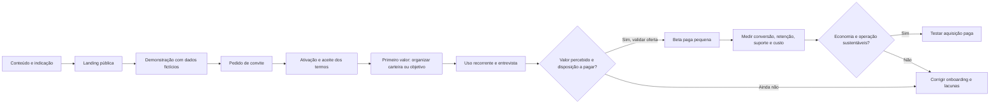
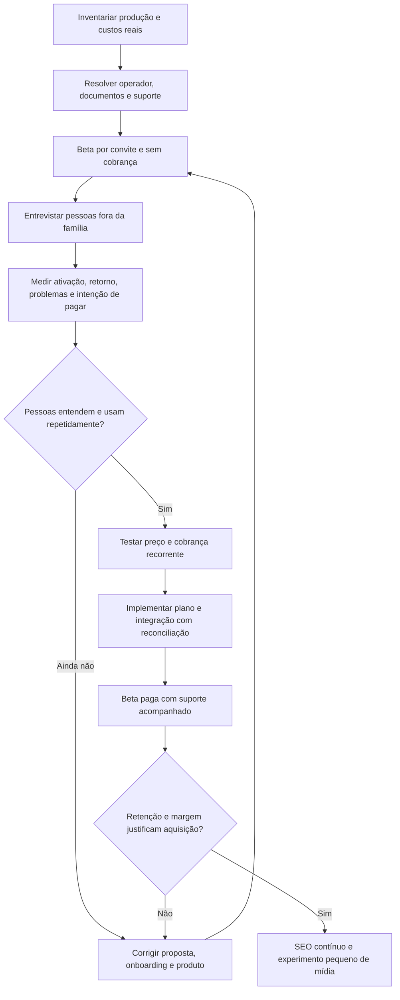

# InvestLab — diagnóstico e plano técnico-comercial

**Status:** planejamento inicial; não constitui parecer jurídico nem confirma prontidão para operação SaaS.
**Escopo desta revisão:** consolidar o plano técnico-comercial, corrigir o estado do fluxo de convites à luz do código atual e organizar uma estratégia inicial de validação comercial. Os documentos públicos ainda contêm pendências institucionais e de revisão; a existência de uma versão de Termos no código não comprova aprovação jurídica. Este documento não constitui parecer jurídico nem confirmação de conformidade.

## Visão e escopo comercial

O InvestLab pretende evoluir de uma aplicação pessoal para um SaaS brasileiro de gestão e acompanhamento de investimentos para pessoas físicas. O produto deve organizar carteiras, patrimônio, aportes, movimentações, proventos e indicadores com fontes e limitações explícitas, sem oferecer consultoria individualizada, recomendar ativos específicos ou executar ordens.

O modelo comercial ainda é hipótese: plano Free, plano Pro, beta fechado inicialmente gratuito e demonstração pública com dados fictícios. Preços, elegibilidade dos planos, entidade responsável pela operação e condições comerciais precisam ser validados antes do lançamento.

## Diagnóstico técnico atualizado

O repositório representa um monólito Next.js com a aplicação, APIs, serviços e acesso PostgreSQL/Neon no mesmo projeto. A documentação e o código verificados mostram:

| Tema                   | Estado observado no código                                                                                                                                                                                                                                                                                                                                                                                                                                                                                    | Consequência para o plano                                                                                                                                                                                                                                 |
| ---------------------- | ------------------------------------------------------------------------------------------------------------------------------------------------------------------------------------------------------------------------------------------------------------------------------------------------------------------------------------------------------------------------------------------------------------------------------------------------------------------------------------------------------------- | --------------------------------------------------------------------------------------------------------------------------------------------------------------------------------------------------------------------------------------------------------- |
| Autenticação e sessões | Better Auth oferece contas individuais, sessão por cookie `HttpOnly`, `SameSite=Lax` e `Secure` em produção; a expiração padrão da sessão observada na configuração instalada é de sete dias. Convites, login, redefinição de senha e autorização por papel existem. O proxy protege rotas e o servidor verifica a sessão. O código atual define `CURRENT_TERMS_VERSION` e a ativação do convite compara e registra a versão enviada; isso comprova comportamento técnico, não aprovação jurídica dos Termos. | O beta continua baseado em convite e requer avaliação operacional e jurídica dos documentos vigentes antes de ampliar acesso. Revisar isolamento e privilégios com testes de autorização; configuração real de produção ainda não foi verificada.         |
| Administração          | Existem rotas e telas administrativas protegidas por papel `ADMIN`, incluindo usuários, convites e sincronizações globais. A visualização temporária de suporte usa cookie próprio de 30 minutos.                                                                                                                                                                                                                                                                                                             | Manter privilégio mínimo, escopo de suporte limitado e evidências de auditoria adequadas. A existência do papel não prova que o acesso operacional esteja corretamente configurado em produção.                                                           |
| Navegador              | O código usa `localStorage` para tema, preferências de critérios, tickers recentes e escolha de cookies. Cookies funcionais incluem sessão Better Auth e cookie temporário de suporte. A busca estática não encontrou scripts explícitos de analytics/rastreamento nem categorias opcionais.                                                                                                                                                                                                                  | Política provisória documenta o inventário do repositório. O banner permite aceitar ou rejeitar cookies opcionais; cookies necessários permanecem ativos. A auditoria em runtime e a configuração de hospedagem continuam pendentes.                      |
| Importações            | Fluxos recebem arquivos XLSX da B3 para prévia e confirmação, processando bytes em memória e persistindo registros derivados e metadados de importação. O ciclo de vida de buffers, temporários e backups ainda precisa ser verificado.                                                                                                                                                                                                                                                                       | Tratar extratos e posições como dados financeiros pessoais de alta sensibilidade prática; fechar o inventário de persistência e exclusão antes de prometer retenção ou apagamento.                                                                        |
| Persistência           | O esquema contém dados de importação, posições, movimentações, objetivos, classificações e configurações de carteira. A base usa PostgreSQL via Neon, conforme README.                                                                                                                                                                                                                                                                                                                                        | Mapear dados por titular, finalidade, acesso, retenção, cópias de segurança, restauração e localização do serviço; a configuração de produção não foi verificada.                                                                                         |
| Logs                   | Há logs JSON com rota, método, status, duração e eventos de negócio. O logger serializa mensagens e pilha de erros passadas como contexto; o conteúdo e a retenção do destino operacional não foram identificados.                                                                                                                                                                                                                                                                                            | Auditar campos e destinos, reduzir dados pessoais/financeiros e definir acesso, retenção e trilha de auditoria. Logs operacionais não são automaticamente a auditoria administrativa proposta.                                                            |
| Integrações            | O código contém provedores para BRAPI e CVM e consultas a séries do BCB; também carrega logos de `icons.brapi.dev`. Contratos, suboperadores, tráfego enviado, regiões e transferências internacionais não foram verificados.                                                                                                                                                                                                                                                                                 | Confirmar fornecedores, finalidades, dados compartilhados, localização, termos e salvaguardas antes de concluir avisos ou documentos.                                                                                                                     |
| Direitos e documentos  | Há páginas `/termos-de-uso`, `/privacidade` e `/cookies`; o código registra a versão corrente aceita na ativação por convite. A central autenticada `/privacidade-conta` lista documentos e registros. Permanecem pendências institucionais e de revisão nos textos públicos; não há preferências opcionais, canal de privacidade confirmado, exportação nem exclusão automatizada.                                                                                                                           | Não inferir aprovação jurídica a partir da versão definida em código. Não preencher retroativamente aceites nem alterar sessões ou histórico de contas existentes. Estabelecer canal e procedimento operacional antes de anunciar atendimento definitivo. |

Este levantamento combina inspeção estática do repositório com os testes registrados nesta tarefa; não é uma auditoria de produção nem um inventário completo. Cookies, armazenamento, tráfego de rede, configuração de hospedagem, retenção de logs, backups e acesso de operadores precisam de verificação em runtime e com os responsáveis antes de afirmar conformidade.

## Bloqueio de ativação e requisitos de liberação

- O estado observado em 20/10/2026 difere de versões anteriores deste plano: `src/lib/privacy-policy.ts` define `CURRENT_TERMS_VERSION`, e a ativação por convite verifica e registra essa versão. Não há evidência no repositório de que a revisão jurídica, os dados institucionais ou a configuração da operação tenham sido aprovados.
- Antes de ampliar convites ou anunciar cadastro público, confirmar responsáveis, entidade operadora, canais de contato e aprovação dos documentos com os responsáveis apropriados. Não tratar a constante no código como prova dessa aprovação.
- O aceite atual permanece associado à ativação por convite. Login, sessões existentes e histórico de aceite não devem ser alterados retroativamente; eventual novo aceite exige decisão explícita sobre escopo, comunicação e tratamento das contas que não aceitarem.
- Não há hoje um fluxo para solicitar novo aceite das contas existentes. Qualquer requisito para exigir aceite renovado precisa de decisão explícita de produto/jurídico sobre escopo, comunicação e tratamento das contas que não aceitarem, antes de mudar o comportamento.

## Requisitos de produto e privacidade

1. Preparar Termos de Uso versionados e registrar qual versão foi aceita e quando durante o cadastro, quando houver cadastro individual. O aceite contratual não substitui nem representa consentimento genérico para tratamentos com outras finalidades.
2. Publicar Política de Privacidade clara e acessível, baseada no inventário real e aprovada após definição do controlador, finalidades, bases legais, fornecedores, compartilhamentos, transferências internacionais e retenções.
3. Documentar cookies e tecnologias similares exclusivamente conforme o que estiver efetivamente em uso. Distinguir o estritamente necessário do opcional; só oferecer categorias que existam e tenham finalidade identificada.
4. Se forem encontradas tecnologias opcionais que dependam de autorização, planejar banner com opções equivalentes para rejeitar e personalizar, bloqueio prévio dessas tecnologias e meios persistentes para alterar ou revogar preferências. Não instalar rastreamento opcional antes dessa decisão e do controle técnico correspondente.
5. Planejar uma área **Conta e Privacidade** para acesso aos documentos vigentes e anteriores, consulta e alteração das preferências aplicáveis e envio/acompanhamento de solicitações relativas aos dados pessoais.
6. Separar administração de funcionalidades do investidor. Definir papéis, escopos e acesso por necessidade; não permitir visualização irrestrita de carteiras por administradores. Registrar ações administrativas relevantes e limitar a auditoria ao mínimo necessário.
7. Definir procedimentos para confirmação/acesso, correção, portabilidade quando aplicável, oposição/revogação quando cabível, exportação e exclusão. Especificar efeitos em dados derivados, obrigações de retenção, backups e restauração.
8. Planejar política de retenção por categoria de dado, ciclo de descarte, backup/restauração e resposta a incidentes, incluindo responsáveis, registro, avaliação e comunicações aplicáveis.

## Plano de implementação em etapas

As etapas abaixo continuam válidas para fechar lacunas de governança e operação, mas parte dos fundamentos técnicos já foi implementada em 17/10/2026. A etapa 0 é pré-requisito para aprovação jurídica, confirmação do controlador e decisões de produção; não impede melhorias técnicas independentes. O status por etapa foi atualizado a seguir.

| Etapa                                        | Entrega e critério de saída                                                                                                                                                                                                                                                                                                                                                  | Dependências                                                                                                                                                   |
| -------------------------------------------- | ---------------------------------------------------------------------------------------------------------------------------------------------------------------------------------------------------------------------------------------------------------------------------------------------------------------------------------------------------------------------------- | -------------------------------------------------------------------------------------------------------------------------------------------------------------- |
| 0. Inventário e decisões de governança       | Mapa de dados pessoais por fluxo: coleta, finalidade, base legal a validar, titular, destino, retenção e controles; catálogo de cookies/localStorage/sessões; análise de logs, importações, integrações, fornecedores, transferências, backups e ambientes. Registrar lacunas e responsáveis pelas decisões.                                                                 | Acesso às configurações reais de hospedagem, provedores, logs e backups; identificação da pessoa jurídica/controlador e assessoria apropriada.                 |
| 1. Fundamentos de conta e segurança          | Implementado parcialmente: contas individuais por convite, papéis, autorização de rotas e isolamento por usuário existem. Permanecem threat model, revisão de menor privilégio, validação operacional e controles de acesso excepcional.                                                                                                                                     | Revisão dos fluxos atuais, configuração real de produção, responsáveis e decisões operacionais.                                                                |
| 2. Governança documental e consentimentos    | Implementado parcialmente: documentos provisórios versionados; a ativação de convites está bloqueada até aprovação dos Termos. A infraestrutura de aceite mantém versão e data/hora, mas só aceitará uma versão aprovada pelo servidor. Bases legais e consentimentos específicos não foram presumidos; textos definitivos aguardam revisão jurídica e dados institucionais. | Inventário concluído, informações legais confirmadas e aprovação jurídica; registrar a versão aprovada no código junto da liberação coordenada dos documentos. |
| 3. Cookies e armazenamento opcional          | Inventário estático registrado; o banner permite aceitar ou rejeitar cookies opcionais e mantém cookies necessários ativos. Não foram identificadas tecnologias opcionais no código pesquisado; escolhas não ativam recursos opcionais hoje. Se runtime revelar novas tecnologias, mapear finalidades e garantir bloqueio e escolha antes da ativação.                       | Auditoria em runtime, inventário de hospedagem e revisão se forem encontrados novos rastreadores.                                                              |
| 4. Conta e solicitações do titular           | Implementado parcialmente: central autenticada expõe documentos e histórico de aceite com orientação inicial. Canal institucional, envio/acompanhamento de solicitações e automação de acesso, exportação ou exclusão não estão implementados.                                                                                                                               | Controlador, canal, verificação de identidade, prazos, responsabilidades e política de retenção definidos.                                                     |
| 5. Administração e auditoria                 | Ferramentas administrativas separadas, autorização por função, privilégio mínimo, auditoria protegida, suporte com escopo limitado e sem acesso irrestrito a carteiras.                                                                                                                                                                                                      | Etapa 1 e modelo de suporte aprovado; testes de autorização e isolamento antes de disponibilizar.                                                              |
| 6. Ciclo de vida e resposta operacional      | Procedimentos e automações revisáveis para exportação, retenção, exclusão, backups/restauração, incidentes e comunicação. Validar efeitos sobre registros obrigatórios e dados em cópias.                                                                                                                                                                                    | Inventário, política de retenção, responsáveis, fornecedores e procedimentos incidentais definidos.                                                            |
| 7. Preparação para beta e operação comercial | Rever documentação, segurança, suporte, observabilidade, contratos e controles com fluxos reais; executar validação ponta a ponta com dados sintéticos e beta controlado.                                                                                                                                                                                                    | Critérios das etapas anteriores satisfeitos; aprovação jurídica/operacional para o contexto de lançamento.                                                     |

## Decisões pendentes antes de documentos definitivos

- Quem será a pessoa jurídica controladora e qual canal de contato/encarregado ou canal equivalente será publicado.
- Quais finalidades e bases legais se aplicam a cada fluxo, separando execução contratual, obrigações legais, segurança e consentimentos realmente opcionais.
- Quais fornecedores e suboperadores tratam dados, sob quais instruções, em quais regiões e com quais transferências internacionais e salvaguardas.
- Quais dados entram em logs, arquivos temporários, backups e serviços externos; prazos de retenção e procedimentos de descarte/restauração.
- Qual escopo de suporte/administração será permitido e quais eventos precisam de registro e revisão.
- Quais funcionalidades entram no beta/MVP, quais dados são necessários para elas e quais não devem ser coletados.

## Estratégia comercial inicial — 20/10/2026

### Recomendação executiva

Começar com um beta fechado, por convite, sem cobrar e sem tráfego pago. O primeiro ciclo deve testar se pessoas além do fundador conseguem entender a proposta, carregar ou registrar a carteira, voltar a usar o produto e apontar por que continuariam usando. A demonstração pública com dados fictícios é a chamada principal da landing; o convite continua sendo o caminho de acesso real. Não anunciar “plano gratuito”, assinatura, importação de notas por imagem, curso com quizzes ou recompensas antes de esses fluxos existirem.

Depois de corrigir os bloqueios de operação e observar uso real, testar uma única oferta paga com usuários que já tenham percebido valor. Só então investir em aquisição paga, começando por campanhas pequenas e rastreáveis. Isso evita comprar tráfego para um caminho que ainda termina em “acesso por convite” e permite medir retenção antes de otimizar cliques.

### Produto, público e posicionamento

**Categoria que o código sustenta:** ferramenta web para organizar e acompanhar carteira, objetivos, estratégia e operações pessoais, com demonstração de dados fictícios. A importação B3 existente é de planilhas XLSX com revisão antes de salvar. Acesso real ainda é por convite; não há cadastro público, cobrança, assinatura nem plano Free/Pro implementados.

**Hipótese de público para validar primeiro:** pessoas físicas que já investem em mais de uma instituição ou classe de ativos e sentem dificuldade para entender a situação total e decidir o próximo passo. O fundador e familiares são bons participantes de teste, mas não bastam para demonstrar demanda: incluir pessoas fora do círculo próximo e registrar onde travam.

**Promessa de comunicação a testar:** “Entenda sua carteira como um todo e organize seus próximos passos.” A mensagem deve explicar o que o sistema mostra, de onde vêm os dados e o que ainda depende de atualização/importação manual. Não prometer rentabilidade, proteção contra perdas, recomendação individual, cobertura de todos os ativos nem sincronização automática que o produto não oferece.

### Funil para a fase beta

Instrumentar cada etapa apenas depois de definir finalidade, base legal aplicável, fornecedor, retenção e preferência de cookies. Antes disso, manter um registro manual de convites, entrevistas e problemas, com dados mínimos e acesso restrito. Indicadores iniciais: visitas à landing, início/conclusão da demonstração, pedidos/ativações de convite, conclusão da primeira tarefa de carteira, retorno após 7/30 dias, cancelamentos/pedidos de saída, chamados de suporte, intenção de pagamento e custo mensal por serviço. Não transformar um volume pequeno de entrevistas em taxa de mercado.

### Oferta e preço

| Fase                      | Oferta                                                                                       | Regra de decisão                                                                                                                                                               |
| ------------------------- | -------------------------------------------------------------------------------------------- | ------------------------------------------------------------------------------------------------------------------------------------------------------------------------------ |
| Beta fechada              | Acesso gratuito por convite, com prazo e escopo explicados às pessoas participantes          | Confirmar clareza da proposta, onboarding, confiabilidade dos dados e frequência de uso; não vender como plano Free permanente                                                 |
| Primeiro teste pago       | Uma assinatura mensal simples, com cancelamento claro e conjunto de recursos que já funciona | Entrevistar usuários ativos e testar disposição a pagar antes de fixar preço; comparar receita líquida com taxas, tributos, infraestrutura, suporte e custo de dados           |
| Oferta recorrente         | Considerar anual apenas depois de validar renovação, retenção e suporte                      | Mostrar valor total, período e renovação de forma clara; não usar desconto anual para esconder churn ou falta de valor recorrente                                              |
| Plano gratuito permanente | Decidir após observar custo marginal, suporte e conversão                                    | Definir limites pelos custos e pela experiência suportada (ex.: capacidade de dados/recursos), nunca por número arbitrário de ativos sem validar se faz sentido para o usuário |

Como referência pública observada nesta data, a página do Kinvo anuncia Free e Premium anual por R$ 179,90, com parcelamento divulgado até 12 vezes de R$ 19,90. É um ponto de comparação, não prova de disposição a pagar pelo InvestLab nem recomendação para copiar preço ou escopo. A diferença precisa estar na clareza do todo e no planejamento, não em alegar que possui mais ativos, sincronizações ou retornos calculados do que realmente entrega. [Planos do Kinvo](https://consolidador.kinvo.com.br/planos/)

**Faixa de experimento, não preço aprovado:** entrevistar sobre cenários entre R$ 15 e R$ 25 por mês, usando a faixa apenas para descobrir sensibilidade e objeções; comparar com o preço anual de referência e com o custo real por usuário. Não publicar esses valores ainda. Recalcular após conhecer custos de infraestrutura, dados, atendimento, tributos e a entidade que emitirá a cobrança.

### Canal de venda e marketing

1. **Agora:** convites pessoais, entrevistas curtas e demonstração pública. Recrutar além da família e pedir que a pessoa conclua tarefas sem orientação ao vivo; anotar dúvidas e abandonos.
2. **Em paralelo:** conteúdo útil sobre organização de carteira, importação B3 e leitura de objetivos, sempre mostrando fontes, datas e limitações. SEO é trabalho contínuo de páginas públicas úteis e indexáveis, não inserção repetida de palavras-chave.
3. **Após beta:** medir a conversão e testar uma oferta paga para pessoas que já usam o produto. Priorizar depoimentos autorizados e casos de uso verificáveis, sem números de patrimônio ou retorno sem permissão e contexto.
4. **Tráfego pago:** não iniciar ainda. Começar somente após checkout, cadastro, suporte, medição de conversão e cancelamento funcionarem ponta a ponta; definir um teto de gasto que o fundador aceite perder no experimento e interromper se o custo de adquirir uma conta paga superar a margem esperada.

Para busca orgânica, auditar títulos e descrições por página pública, canonical/OG, `robots.txt`, sitemap, Search Console e conteúdo que responda dúvidas reais. A inspeção do repositório encontrou apenas metadados genéricos no layout e não encontrou arquivos `robots` ou `sitemap`; a indexação e os resultados atuais não foram verificados em produção. Um sitemap pode ajudar descoberta, sem garantir rastreamento, indexação ou posição. [Guia de SEO do Google](https://developers.google.com/search/docs/fundamentals/seo-starter-guide), [visão geral de sitemaps](https://developers.google.com/search/docs/crawling-indexing/sitemaps/overview).

### Cobrança, domínio e infraestrutura

**Cobrança:** não há SDK nem fluxo de checkout no código. Para o piloto gratuito, não integrar pagamentos. Para o primeiro experimento pago, comparar o fluxo de assinaturas do Mercado Pago e Stripe dentro das contas comerciais que serão usadas, com tarifas efetivas, meios habilitados para a conta, prazo de recebimento, reembolso, contestação, falha/retentativa, cancelamento e emissão fiscal. O Mercado Pago documenta assinaturas recorrentes e meios como Pix/cartão/boleto; a Stripe publica 3,99% + R$ 0,39 para cartão nacional e 1,19% para Pix, que a página indica como disponível somente por convite. Confirme elegibilidade e condições diretamente antes de escolher. [API de assinaturas Mercado Pago](https://www.mercadopago.com.br/developers/pt/docs/subscriptions/overview), [tarifas Stripe Brasil](https://stripe.com/br/pricing).

Não tratar pagamento aprovado como “acesso liberado” sem webhook verificado, idempotência, reconciliação, janela de tolerância, cancelamento, reembolso, inadimplência e trilha de suporte. Começar com link/plano de assinatura só é aceitável para validar cobrança manualmente, desde que o beta seja informado e a liberação de acesso tenha dono e processo confiável.

**Domínio:** registrar o nome escolhido diretamente no Registro.br para um domínio `.br`, titularizado pela pessoa/entidade responsável pela operação e não por agência/fornecedor. O preço informado pelo Registro.br é R$ 40 por ano; verificar disponibilidade do nome, marcas e nomes próximos antes da compra. [Registro.br](https://registro.br/dominio).

**Hospedagem:** a afirmação “está na Heroku” veio do usuário, mas não foi possível confirmar a produção. O repositório contém `vercel.json` com cron jobs da aplicação, e o README documenta Neon; isso não prova qual host ou banco estão ligados em produção. Não migrar nem separar frontend/backend sem faturas, métricas e um gargalo concreto. O app já segue monólito Next.js e a separação agora aumenta serviços, operação e pontos de falha sem benefício comprovado. Pela tabela pública da Heroku, Basic Dyno custa US$ 7/mês e Postgres Essential-0 US$ 5/mês (valores de referência, antes de impostos e extras); Vercel Pro mostra US$ 20/mês com US$ 20 de créditos de uso; isso não permite calcular a fatura do InvestLab nem comparar o Neon real. [Heroku pricing](https://www.heroku.com/pricing/), [Vercel Pro](https://vercel.com/docs/plans/pro-plan).

| Custo mensal       | Como apurar antes de escolher ou migrar                                                                                                       |
| ------------------ | --------------------------------------------------------------------------------------------------------------------------------------------- |
| Aplicação e builds | Host atual, plano, uso, logs, tráfego, funções/crons, backups e impostos; pegar fatura dos últimos 3 meses                                    |
| Banco              | Plano Neon/Heroku em produção, armazenamento, compute, egress, backups e limites; identificar se há redundância de banco ou add-ons           |
| Dados de mercado   | Contratos, limites, cobranças, limites comerciais e condições de uso de BRAPI/CVM/outros; código não revela a fatura nem o direito de revenda |
| Pagamento          | Tarifa por método, parcelamento, antecipação, chargeback, reembolso e impostos; calcular custo efetivo sobre ticket observado                 |
| Operação           | E-mail transacional, suporte, domínio, monitoramento, contabilidade, jurídico, tributos e horas do fundador                                   |

Fórmula para tomar decisão de preço: `margem de contribuição por assinante = receita recebida - taxa de pagamento - tributos variáveis - custo variável de dados/infra - suporte variável`. Custos fixos e pró-labore ficam separados. Não foi possível apurar o custo atual porque não consultamos contas de Heroku, Vercel, Neon, provedores, contador ou gateway.

### Cadastro e dados pessoais

Não adicionar telefone, CPF, endereço, patrimônio estimado ou perfil de investidor por conveniência. O fluxo atual usa nome e e-mail e autenticação. Para abrir cadastro self-service, validar finalidade e necessidade de cada campo, proteção antiabuso e recuperação de conta. Telefone só entra se um fluxo concreto de segurança/suporte ou canal opcional de WhatsApp justificar o dado, com finalidade informada, acesso, retenção e alternativa para quem não quiser fornecê-lo. Dados para cobrança devem ser coletados pelo gateway sempre que possível e compartilhados com a aplicação apenas no mínimo necessário. Separar credenciais, contato, dados de cobrança e dados da carteira; mascarar um campo não reduz por si só o risco de coletar e armazenar o dado.

### Melhorias de produto e ordem sugerida

1. **Pronto para beta externo:** confirmar quem opera o serviço, documentos e suporte; validar isolamento por conta, backup/restauração, recuperação de senha, bugs de onboarding e ciclo de exclusão; entrevistar usuários e revisar a demonstração/landing em curso na issue #230.
2. **Pronto para cobrar:** cadastro público e termos no fluxo real, gestão de plano/entitlement, checkout/webhooks, cancelamento, reembolso, inadimplência, recibos e suporte. Definir o plano Free e o que restringe antes de criar papéis de usuário: separar “papel de acesso” (`USER`/`ADMIN`) de “plano comercial” (`Free`/`Pro`), para não transformar plano em privilégio administrativo.
3. **Crescimento:** SEO técnico e conteúdo, métricas de funil respeitando privacidade, melhoria de ativação e eventual mídia paga depois de conversão demonstrada.
4. **Diferenciação futura:** aprendizado interativo, quizzes, celebrações/recompensas com opção discreta e acessível; manter animações sem pressão sobre decisões financeiras.
5. **Entrada por imagem:** começar como extração assistida de nota/documento em rascunho, mostrando origem, campos, confiança e correções antes de qualquer gravação. Primeiro limitar formatos/casos apoiados (por exemplo, notas de corretagem B3 que sejam realmente suportadas), testar falsos positivos, excluir o arquivo bruto conforme política definida e exigir confirmação explícita. Não criar conta nem lançar movimento financeiro automaticamente a partir de qualquer imagem/chat.

### Plano de decisão e fluxograma de execução

### Itens de backlog a registrar

As sugestões abaixo são trabalho futuro, não capacidades disponíveis. A landing issue #230 continua sendo trabalho separado. Os itens novos devem ser ligados ao Project existente e receber prioridade conforme o produto valide cada etapa.

- [#231 — Validar planos Free/Pro, limites e preço](https://github.com/DavidSilva32/investlab/issues/231).
- [#232 — Planejar cadastro público e onboarding por conta](https://github.com/DavidSilva32/investlab/issues/232).
- [#233 — Implementar assinaturas e acesso pago com reconciliação](https://github.com/DavidSilva32/investlab/issues/233).
- [#234 — Preparar SEO técnico e conteúdo orgânico](https://github.com/DavidSilva32/investlab/issues/234).
- [#235 — Medir o funil de aquisição e ativação com privacidade](https://github.com/DavidSilva32/investlab/issues/235).
- [#236 — Criar importação assistida de notas por imagem/documento](https://github.com/DavidSilva32/investlab/issues/236).
- [#237 — Evoluir aprendizado com quizzes e celebrações acessíveis](https://github.com/DavidSilva32/investlab/issues/237).
- [#238 — Auditar custos e produção antes de decidir hospedagem](https://github.com/DavidSilva32/investlab/issues/238).

Os issues foram criados, atribuídos e receberam a label `enhancement`. A inclusão no GitHub Project existente ainda está pendente: o `gh auth status` local informa que o token da conta `DavidSilva32` é inválido, e a integração GitHub disponível nesta sessão não oferece operações para adicionar itens ou alterar campos do Projects. Não considerar a organização do Project concluída até confirmar essas relações na interface/API do Project.

### Fontes e limites desta revisão

Pesquisa de páginas públicas em 20/10/2026. Preços, taxas, elegibilidade, recursos e termos podem mudar; confirmar com cada fornecedor antes da contratação. A definição de serviços de consultoria de valores mobiliários depende da forma concreta de orientação prestada; como o produto trabalha com decisões financeiras e investimentos, revisar textos, automações e suporte com assessoria regulatória adequada antes de vender. A CVM descreve consultoria como orientação, recomendação e aconselhamento profissional, independente e individualizado, e remete à Resolução CVM 19; a redação comercial não deve tentar resolver essa classificação por si só. [CVM — consultores de valores mobiliários](https://www.gov.br/cvm/pt-br/assuntos/regulados/consultas-por-participante/consultores-de-valores-mobiliarios), [Resolução CVM 19](https://conteudo.cvm.gov.br/legislacao/resolucoes/resol019.html).

## Referências oficiais consultadas

- ANPD, [Guia orientativo Cookies e proteção de dados pessoais](https://www.gov.br/anpd/pt-br/centrais-de-conteudo/materiais-educativos-e-publicacoes/guia-orientativo-cookies-e-protecao-de-dados-pessoais), publicação de 22/11/2024, página atualizada em 23/01/2025.
- ANPD, [Direito dos Titulares](https://www.gov.br/anpd/pt-br/assuntos/titular-de-dados-1/direito-dos-titulares).
- ANPD, [Guia Orientativo sobre Segurança da Informação para Agentes de Tratamento de Pequeno Porte](https://www.gov.br/anpd/pt-br/assuntos/noticias/anpd-publica-guia-de-seguranca-da-informacao-para-agentes-de-tratamento-de-pequeno-porte).
- ANPD, [Guia Orientativo para Definições dos Agentes de Tratamento de Dados Pessoais e do Encarregado](https://www.gov.br/anpd/pt-br/assuntos/noticias/nova-versao-do-guia-dos-agentes-de-tratamento).

As orientações da ANPD são referências para o trabalho de conformidade. Este documento não determina bases legais, substitui análise jurídica ou afirma que o InvestLab já cumpre os requisitos aplicáveis.

## Evidências no repositório

- [README](../../README.md) — arquitetura, banco e provedores indicados.
- [Sessão](../../src/infrastructure/auth/session.ts), [login](../../src/app/api/auth/login/route.ts), [proxy](../../src/proxy.ts) e [configuração de credenciais](../../src/infrastructure/auth/auth-configuration.ts).
- [Configurações](<../../src/app/(private)/settings/page.tsx>) e [inventário das rotas ativas](../design/active-route-inventory.md).
- [Preferências locais](../../src/lib/stock-criteria-preferences.ts), [histórico recente](<../../src/app/(private)/analyses/_components/stock-analysis-dashboard.tsx>) e [provedor de tema](../../src/components/theme-provider.tsx).
- [Fluxo de importação](../../src/components/portfolio-import.tsx), [serviço de importação](../../src/backend/services/import.service.ts) e [repositório de importação](../../src/backend/repositories/import.repository.ts).
- [Esquema do banco](../../src/infrastructure/database/schema.ts), [logger](../../src/infrastructure/logging/logger.ts) e [logging de requisições](../../src/infrastructure/logging/api-request.ts).
- Provedores em `src/backend/providers/` e consultas BCB em `src/backend/services/bcb-*`.
